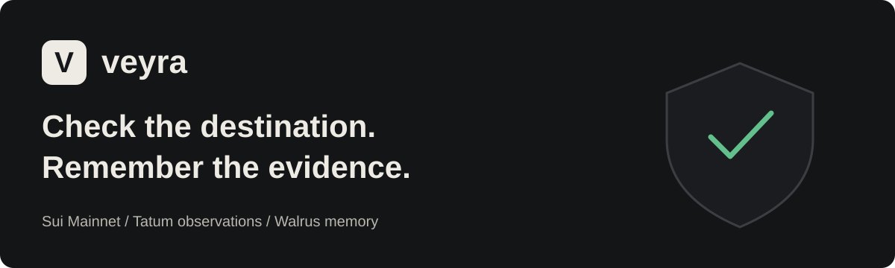
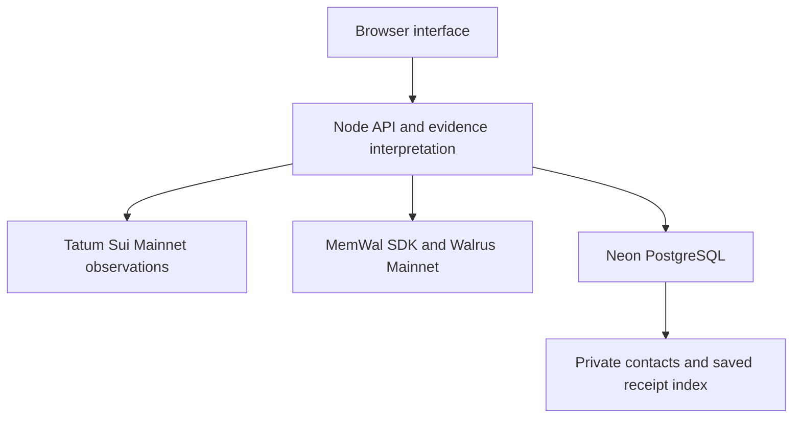

<p align="center"></p>

<p align="center"><a href="https://veyra-rs1l.onrender.com/">Open Veyra</a> · <a href="https://veyra-rs1l.onrender.com/docs#build-story">Read the build story</a> · <a href="docs/INTEGRATION-EVIDENCE.md">Inspect integration evidence</a></p>

# Veyra

Veyra helps people review a **Sui Mainnet recipient address before sending funds**. It compares the full destination with remembered evidence, explains differences or uncertainty, and lets visitors save their own assessment to Walrus without wallet sign-in or builder assistance.

A familiar prefix or suffix can hide a different address. Transaction history can also contain misleading entries. Veyra preserves the source and meaning of a remembered claim instead of treating every past interaction as approval.

**Veyra never signs, executes or authorizes payments.** A matching record is evidence to review, not proof of identity, current ownership or recipient intent.

## Use the product

| Journey | What happens | Sign-in |
|---|---|---|
| [Check an address](https://veyra-rs1l.onrender.com/) | Compare a recipient identifier and full Sui address with available Walrus evidence. Optionally inspect a real historical transaction through Tatum. | None |
| Save this check | Review the exact assessment and disclosure, consent, then follow a genuine storage job to its completed Walrus receipt. | None; protected browser access |
| [Activity History](https://veyra-rs1l.onrender.com/history) | Return to saved receipts, request a fresh Walrus recall, or obtain a private rotating recovery code. Temporary session history is separately labelled. | Same browser or recovery code |
| [Saved recipients](https://veyra-rs1l.onrender.com/contacts) | Invite a recipient, obtain a signed receiving statement, independently verify and accept it; recheck or revoke the relationship. | Sui wallet |
| [Receive & Verify](https://veyra-rs1l.onrender.com/verify-wallet) | Inspect wallet-control verification separately from recipient identity and public publication. | Wallet for signing |
| [Memory & Records](https://veyra-rs1l.onrender.com/memory) | Inspect namespace metadata and recalled evidence, including source and record type. | None for public evidence |

A new address with no evidence receives an unknown/manual-review result. Checking it does not silently register a recipient or save a memory. Optional assessment saving preserves what was checked; it does not create a trusted recipient baseline.

## Why memory matters

Walrus recipient evidence changes the next check: no baseline, a matching remembered claim, a different address, or conflicting claims each produce a different explanation. A newer claim does not silently replace an older accepted address.

Saved assessment memories serve a separate purpose: revisit the finding, timestamp and evidence references used for that check. They explicitly retain `recipientConfirmed:false`, `identityVerified:false` and `paymentAuthorized:false`. Private relationship labels and browser credentials are excluded from the Walrus record.

Read the [sourced problem analysis and build story](docs/TECHNICAL-BLOG.md). It covers documented incidents, recovery outcomes and academic research without claiming Veyra prevented those historical losses.

## Genuine integration evidence

| Evidence | Verified result | Boundary |
|---|---|---|
| Hosted self-service save, 25 October 2026 | One consented assessment completed with a real MemWal job and Mainnet blob. | A saved assessment, not a payment or recipient approval. |
| Recall and return | Expected blob and exact record hash matched through MemWal; saved history survived a new tab and deployment. | Relayer verification; independent ciphertext decryption is not claimed. |
| Mainnet inventory | Ten unique active blobs in the captured namespace snapshot. | Includes two SDK checks and three package observations; not ten verified recipients. |
| Tatum Sui Mainnet | Genuine transaction observations and hosted match/mismatch checks. | Historical participation does not prove intended payee or ownership. |
| Automated verification | Last verified release: 191 CI tests with PostgreSQL 17 and SQLite; six hosted read-only checks. | Local lifecycle fixtures are explicitly not Mainnet success evidence. |

Inspect the [completed save and exact record](docs/evidence/2026-10-25-saved-assessment-acceptance.json), [ten-record inventory](docs/evidence/2026-10-25-inventory-after-save.json), [integration history](docs/INTEGRATION-EVIDENCE.md) and [saved-assessment design](docs/SAVED-ASSESSMENTS.md).

## Architecture



- `apps/web/` contains the consumer interface, theme, contacts, history and documentation.
- `scripts/preflight-api.mjs` serves the UI and integrated assessment routes.
- `src/core/unified-recipient-evidence.ts` interprets supported record types without rewriting stored memories.
- `scripts/saved-assessments-api.mjs` and `src/core/saved-assessments.ts` enforce exact-record consent, browser isolation, durable quotas, idempotency, receipt status and recovery rotation.
- `scripts/private-relationships-api.mjs` and `src/core/recipient-relationships.ts` manage wallet-authenticated private relationships.
- `src/core/relationship-database.ts` supports persistent PostgreSQL hosting and local SQLite, with transactional coordination and verified hosted TLS.

The browser holds an HttpOnly access cookie; the server stores hashed credentials and a private history index in Neon. Walrus receives the reviewed assessment record through the existing account policy. This is not user-controlled end-to-end encryption: the service can read its account’s memories.

## Run locally

Requires **Node.js 24**, npm, and legitimate provider credentials for live integrations. An unconfigured service must report missing providers, not invent results.

```bash
npm ci
npm run check
npm test
cp .env.example .env.local
```

Fill `.env.local` privately, then run:

```bash
node --experimental-strip-types --env-file=.env.local scripts/preflight-api.mjs
```

Open `http://127.0.0.1:8787`. Never commit the environment file or database credentials.

| Configuration | Purpose |
|---|---|
| `TATUM_API_KEY`, `SUI_PROTO_DIR` | Genuine Tatum Sui gRPC observations; use the official Sui proto definitions described in the deployment guide. |
| `MEMWAL_PRIVATE_KEY`, `MEMWAL_ACCOUNT_ID` | Server-only delegated Walrus Memory access. |
| `MEMWAL_SERVER_URL`, `MEMWAL_NAMESPACE` | Reviewed relayer endpoint and application namespace. |
| `VEYRA_RELATIONSHIP_DB` | Absolute private SQLite path for local persistent contacts and saved checks. |
| `DATABASE_URL` | Hosted Neon alternative. Configure either PostgreSQL or SQLite, never both. |
| Hosted origin and review flags | Explicit activation described in the deployment guides; never enable by guessing values. |

See [.env.example](.env.example), [Render deployment](docs/RENDER-DEPLOYMENT.md), [free Neon setup](docs/NEON-SETUP.md) and [private relationship security](docs/PRIVATE-RECIPIENT-RELATIONSHIPS.md).

`npm test` exercises real local SQLite persistence and labelled crypto/lifecycle fixtures. Set `TEST_DATABASE_URL` to a disposable PostgreSQL test database to run its database journeys; CI does this with PostgreSQL 17. Never point tests at production. Live SDK write scripts create real Mainnet records and must only be used for an intentional, reviewed save.

## Security and practical limits

- Same-origin POSTs, CSRF, bounded JSON requests, protected cookies and current-credential checks guard saved history. Recovery rotates access and invalidates the previous browser credential/code.
- Server-authenticated assessment tickets and exact record hashes bind consent. Durable idempotency and limits prevent browser rotation or restart from resetting storage allowance.
- Current save limits: three submissions per browser per day, twenty across the service per day and one hundred total. Failed/uncertain submissions consume allowance. Provider outages and exhausted allowances are reported; no paid fallback is initiated.
- Unknown provider acceptance is not blindly retried. The crash window between provider acceptance and saving its job ID needs reconciliation rather than a duplicate write.
- Similarity recall is non-exhaustive. Walrus storage leases can expire. A browser cookie lasting up to 180 days does not guarantee 180 days of Walrus storage.
- Keep recovery codes and exports private. Clearing browser data without retaining recovery access can lose access through the app.
- Signed **public recipient-confirmation publication remains disabled** independently of available assessment saving. Direct independent SEAL ciphertext decryption remains unavailable without approved Mainnet access; no paid Enoki subscription is required for the deployed save/relayer-recall journey.

Review the [integrated product contract](docs/INTEGRATED-PRODUCT-CONTRACT.md), [publication gates](docs/WALRUS-PUBLICATION-GATES.md) and [fixed acceptance checklist](docs/RELEASE-ACCEPTANCE.md). Automated coverage does not replace physical-device or real-wallet failure acceptance.

## Appearance and accessibility

The interface follows the settled Pokter reference treatment: cream canvas and dark ink in light mode, charcoal surfaces and light text in dark mode, with restrained green status indicators. Navigation, readable evidence sections, visible keyboard focus and responsive layouts support the same workflow across screen sizes. The coloured banner above uses that product palette; it is branding, not a safety indicator.

## Total Recall submission

Recommended track: **Consumer Finance Apps**. Walrus supplies durable memory; Tatum supplies relevant Sui blockchain observations. Tatum AI Builder is not claimed as the primary development platform.

The [official rules](https://thewalrussessions.wal.app/tatum-total-recall) require Mainnet memory writes, at least ten memories, relevant Tatum usage, a published blog, working demo/public repository and a two-to-three-minute video. The [published article](https://veyra-rs1l.onrender.com/docs#build-story) and evidence are available. The actual video and final form submission remain outstanding; meeting the captured inventory count is not an organizer eligibility ruling.

See [submission readiness](docs/SUBMISSION-READINESS.md), [submission copy](docs/SUBMISSION-COPY.md) and [recording plan](docs/DEMO-RECORDING-SCRIPT.md). Deadline: **10 November 2026, 17:00 UTC / 18:00 WAT**.

Built by **Aje Oluwaseun Isaac ([0xaje](https://github.com/0xaje))**.
